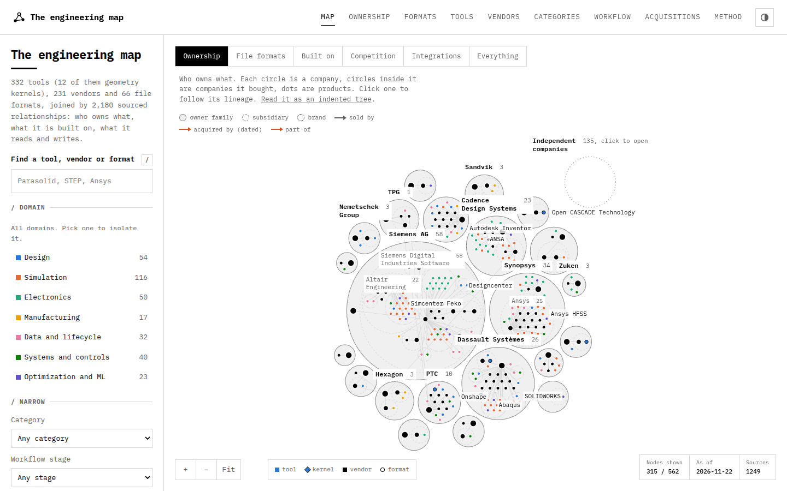
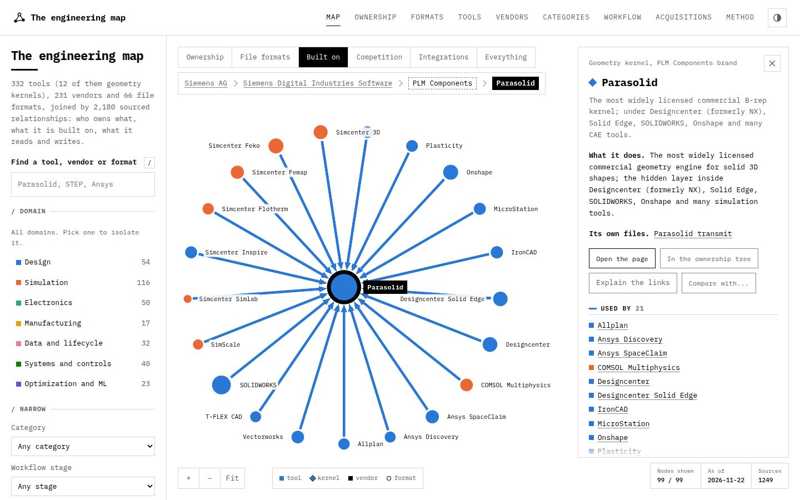
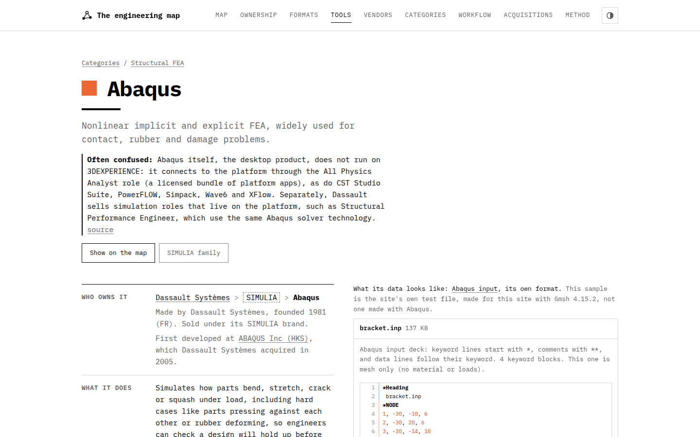
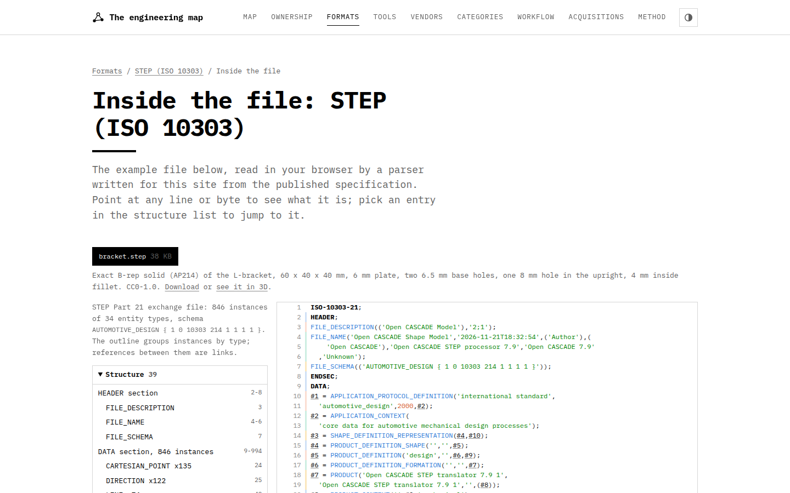

# The engineering map

**Who owns your CAD tool? What geometry kernel is it built on? Which formats can it trade with
your simulation software?** The engineering map answers those questions for 332 tools across
CAD, CAE, CFD, EDA, CAM, PLM and more, with a source behind every fact.

**[Open the map → engineering-map.mchaseallen.com](https://engineering-map.mchaseallen.com)**

[](https://github.com/MC-Meesh/engineering-map/actions/workflows/ci.yml)
[](LICENSE)
[](data/LICENSE)
[](CONTRIBUTING.md)

<picture>
  <source media="(prefers-color-scheme: dark)" srcset="docs/images/map-dark.png">
  
</picture>

Engineering software is one of the most consolidated industries there is. Fluent, Abaqus,
STAR-CCM+ and SOLIDWORKS were each started by a different company; today a handful of groups
own nearly all of them, and the deals keep coming. None of that is visible from a
vendor's website. Neither is the fact that dozens of competing CAD and CAE products run on the
same few geometry kernels, or which formats actually carry a model from one tool to the next.

The map puts that hidden structure in one place, in plain language:

| | |
|---|---|
| **332 tools** | CAD, CAE, CFD, EDA, CAM, PLM, MBSE, robotics, ML surrogates; 12 of them geometry kernels |
| **231 vendors** | with ownership chains back to the group that owns them today |
| **95 acquisitions** | dated by completion, each with its own source |
| **66 file formats** | most with a real example file you can download, view in 3D or inspect byte by byte |
| **2,180 relationships** | every one derived from a sourced field, never drawn by hand |

## What you can do with it

### See what a product is really built on

Pick any tool, vendor or format and switch lenses: ownership, file formats, built on,
competition, integrations. Here is everything built on Siemens' Parasolid kernel, including
products from Dassault, Ansys and Bentley.

<picture>
  <source media="(prefers-color-scheme: dark)" srcset="docs/images/map-kernel-dark.png">
  
</picture>

### Understand a tool in a minute

Every tool page says who owns it and how it got there, what it does in plain language, which
formats it reads and writes, what its data looks like, and where it sits in an engineering
workflow. Common misconceptions get called out with a source.

<picture>
  <source media="(prefers-color-scheme: dark)" srcset="docs/images/tool-dark.png">
  
</picture>

### Look inside the file

Format pages include an example file (most made for this project and released as CC0) and an
inspector that parses it in your browser from the published specification. Point at any line or
byte to see what it is.

<picture>
  <source media="(prefers-color-scheme: dark)" srcset="docs/images/inside-dark.png">
  
</picture>

There is also an interop matrix (formats by category), a workflow view (tools by stage with the
formats that carry each hand-off), an ownership tree, and a timeline of every acquisition.

## Contributing

The map is only as good as its facts, and the people who use these tools every day know things
no website says. Corrections and additions are very welcome, and most need no programming:

- **Fix a fact.** Every tool, vendor and format page has an **Edit this record** link that
  opens its YAML file in GitHub's editor. Change it, cite a source, propose the change.
- **Report a problem.** The **report a problem** link opens an issue with the record filled in.
- **Settle an open question.** [`docs/ROADMAP.md`](docs/ROADMAP.md) lists facts the map could
  not confirm yet (which kernel does Revit use?). A vendor page or release note that answers one
  is a great first contribution.
- **Keep it fresh.** A weekly job opens a "Maintenance report" issue with dead source links and
  records not re-checked in a year.

Read [`CONTRIBUTING.md`](CONTRIBUTING.md) for the data rules. Every pull request is validated by
CI and reviewed before it reaches the site.

## Running it locally

Needs Node 22.

```sh
npm ci
npm run dev        # validates the data, then serves on http://localhost:3480
npm run build      # validate + static build into dist/
npm run data       # validation only: schema, references, ids, layout
```

The build fails on any schema error, unknown reference, duplicate id or em dash in the data, so
if `npm run data` passes, the site will build.

### Layout

| Path | What it holds |
|---|---|
| `data/{tools,vendors,formats,acquisitions,brands}/<id>.yaml` | One file per record. The source of truth. |
| `data/taxonomy.yaml` | Domains, categories and workflow stages. |
| `data/plain.yaml`, `data/structure.yaml` | Plain-language category explainers and file-format layouts. |
| `data/examples/` | Manifests (license, size, sha256) for the files in `public/examples/`. |
| `schema/schemas.json` | JSON Schema for each record type. |
| `scripts/build-graph.mjs` | Validates the data, derives edges, computes layouts, writes the graph. |
| `src/` | The Astro site. `src/scripts/map.ts` is the interactive map (sigma.js on graphology). |
| `docs/decisions/` | Why things are the way they are. Read before proposing a structural change. |

Other scripts: `npm run check-links` (checks every source URL), `npm run stale` (records not
re-checked in a year), `npm run e2e` and `npm run shots` (browser checks against a running
preview; set `CHROME_PATH` if Chrome is not at `/usr/bin/google-chrome`).

## License

- **Code** (everything outside `data/` and `public/examples/`): [MIT](LICENSE).
- **Data** (`data/`): [CC BY-SA 4.0](data/LICENSE). Reuse it freely with attribution, and share
  changes to the data under the same license.
- **Example files** (`public/examples/`): each file's license is in its manifest in
  `data/examples/`. Ours are CC0; third-party files keep their own licenses, shipped beside them.
- Third-party libraries: [`docs/third-party-licenses.md`](docs/third-party-licenses.md).

Product and company names are trademarks of their owners and are used only to identify them.
The project is not affiliated with any vendor listed.

Started by [Chase Allen](https://www.mchaseallen.com).
